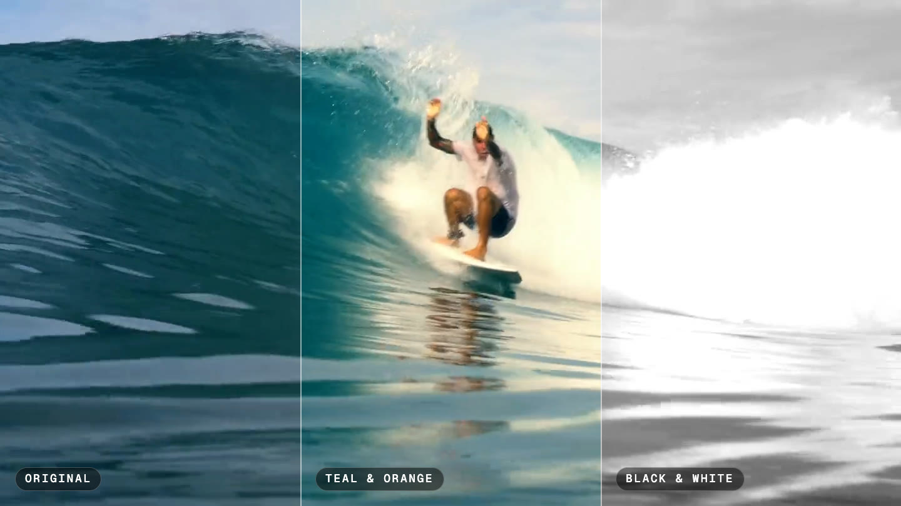

<p align="center">
  
</p>

<h1 align="center">EditMax</h1>

<p align="center">
  A native macOS video editor that your coding agent can drive.<br>
  Cut, grade, caption and deliver by hand, by chat, or from Claude Code, Codex and Cursor over MCP.
</p>

<p align="center">
  <a href="https://github.com/SkidGod4444/editmax/releases/latest"></a>
  <a href="https://github.com/SkidGod4444/editmax/releases"></a>
  <a href="https://github.com/SkidGod4444/editmax/actions/workflows/test.yml"></a>
  <a href="LICENSE"></a>
  
  
  
</p>

<p align="center">
  
  <br>
  <sub>One surf clip graded three ways in EditMax: as shot, Teal &amp; Orange, and Black &amp; White.</sub>
</p>

EditMax is a real editor first: tracks, trims, keyframes, color, audio, captions, multicam, 10-bit delivery, built on
AVFoundation and Core Image with its own compositor, so what you see in the preview is what exports. Then it opens
every one of those operations to agents through a local [Model Context Protocol](https://modelcontextprotocol.io)
server, and ships a chat panel that drives the coding agents you already have, with their own logins. No account,
no backend, nothing leaves your Mac unless you ask a cloud model.

<p align="center">
  
  <br>
  <sub>A cut an agent made in EditMax in nine tool calls: three aerial shots, a Teal &amp; Orange look, two dissolves, fades and a title.</sub>
</p>

## Why EditMax

- **Agents work the same timeline you do.** Every edit, yours or the agent's, goes through one implementation with
  the same validation, so an agent cannot do anything the UI could not.
- **Nothing is ever lost.** A labeled version is recorded before every edit. ⌘Z undoes the agent's work like your
  own; the History tab shows every version with a line saying what changed, and restoring one is itself an edit.
- **Agents can see.** `capture_frame` returns the composed frame at any moment, `frame_stats` measures it,
  `ui_screenshot` shows the window, and `set_playhead` points you at the moment the agent is talking about.
- **Bring your own agent.** Claude Code, Codex, OpenCode, Cursor, Grok and Antigravity through the bundled agent
  runtime, or an API key for Claude, OpenAI, Gemini or xAI. Any MCP client can connect from outside the app too.
- **Private by default.** The MCP server listens on loopback only and requires a bearer token. Transcription runs
  on-device. Prompts and keys never reach the logs.

## New on main, in the next release

The current download (0.1.1) does not have these yet. They are on `main` and ship with the next release:

- **Color:** lift/gamma/gain/offset wheels, RGB and hue-vs-saturation curves, grade layers with shape, color and AI
  subject masks, shot match, RGB parade and vectorscope, grain, glow, vignette, sharpen and noise reduction.
  [docs/color.md](docs/color.md)
- **Effects:** green-screen key, 19 blend modes, face blur that follows faces, animated titles and lower thirds, 14 new
  transitions, HDR output (HLG, PQ). [docs/effects.md](docs/effects.md)
- **Sound:** compressor, true-peak limiter, de-esser, hum removal, loudness normalization, audio crossfades, a mixer
  with pan, solo, buses and a master limiter. [docs/audio.md](docs/audio.md)
- **Editing:** roll, slip and slide trims, J and L cuts, a source viewer with insert, overwrite and fit to fill, match
  frame, scene cut detection, relink and consolidate media, smooth slow motion. [docs/editing.md](docs/editing.md)
- **Follow the agent:** while an agent edits, the window shows where: the clip is selected, the playhead moves onto
  it, the inspector scrolls to the setting that changes and the mixer opens for a mix change. It waits while you use
  the mouse or keyboard, and can be turned off in Settings.
- **Assets:** everything you have imported or added, in one place on the Home screen, with what each file is used in.
  A Library tab in the editor adds any of it to the project. [docs/assets.md](docs/assets.md)
- **Notch drawer:** drag a file to the notch at the top of the screen to add it to Assets. New files in Downloads
  show up there too, ready to add. [docs/assets.md](docs/assets.md)
- **Fonts:** all of Google Fonts, sorted by trending or popular, plus your own .ttf and .otf files. Pick a font and
  weight for any title; a project that uses a Google font fetches it on another Mac. [docs/fonts.md](docs/fonts.md)
- 115 MCP tools (63 in 0.1.1).

## Highlights

| | |
|---|---|
| **Timeline** | Video and audio tracks, ripple insert and delete across every track, roll, slip and slide trims, J and L cuts, a source viewer with insert, overwrite and fit-to-fill edits, match frame, scene cut detection, snapping, markers, in/out points, frame thumbnails and waveforms, proxies, relink and consolidate media |
| **Color** | Exposure, temperature and tint, tone curve, lift/gamma/gain/offset wheels, custom RGB and hue-vs-saturation curves, grade layers with shape, color and AI subject masks, shot match, six built-in looks or any `.cube` LUT, input LUTs for log footage, waveform, RGB parade, vectorscope and histogram, before/after |
| **Effects** | Green-screen key, 19 blend modes, face blur that follows faces, film grain, glow, vignette, sharpen and noise reduction, animated titles and lower thirds, dissolves, dips, wipes, push, slide, zoom, iris and blur transitions |
| **Motion** | Keyframes on every transform, color, opacity, volume and speed value with linear, smooth and hold easing; speed ramps with freeze frames; smooth slow motion (frame blending or optical flow); auto-reframe for vertical cuts; stabilization |
| **Sound** | Three-band EQ, high-pass, noise gate, compressor, true-peak limiter, de-esser, hum removal, voice isolation, loudness measurement and normalization to a target (−14 LUFS for YouTube, −16 for podcasts, −23 for broadcast), audio crossfades, a mixer with pan, solo, buses and a master limiter, auto-ducking of music under speech |
| **Speech** | On-device transcription, captions in six styles, remove silence and filler words, search and cut by the words that were spoken |
| **Structure** | Multicam clips synced by audio, nested sequences, templates for every social format, batch export to several formats at once |
| **Delivery** | H.264 MP4, 10-bit HEVC and ProRes masters in SDR or HDR (HLG, PQ), FCPXML and EDL to hand the cut to DaVinci Resolve or Final Cut Pro, YouTube chapters from markers |
| **Agents** | 115 MCP tools covering all of the above plus the window itself; an in-app chat with a policy that allows only editor tools |

## Install

EditMax runs on macOS 15 or later on Apple silicon. Liquid Glass and on-device SpeechAnalyzer captions need macOS 26;
everything else works on 15. Intel Macs are not supported: the bundled agent runtime is built for Apple silicon only.

1. Download `EditMax-<version>.dmg` from the [latest release](https://github.com/SkidGod4444/editmax/releases/latest).
2. Open it and drag EditMax to Applications.

Releases are signed with a Developer ID and notarized by Apple, so EditMax opens like any other app. If a release's
notes say it is not notarized, open it once, then click **Open Anyway** in **System Settings > Privacy & Security**,
or run `xattr -dr com.apple.quarantine /Applications/EditMax.app`.

Every release also ships a zip and a `SHA256SUMS` file (`shasum -a 256 -c SHA256SUMS` checks the download). Prefer
building it yourself? See [Build](#build).

**Updates.** Every release after 0.1.1 updates itself: once a day it checks for a new release, downloads it in the
background, then asks: **Install Now** (EditMax saves your projects and restarts) or **Remind Me Later** (the popup
again every 2 hours while you use EditMax, a Mac notification every 6 hours while it runs in the background; it installs
the next time you quit either way, and the next open says it is installed). Settings ▸ General can make it ask before downloading or check only when you
choose EditMax ▸ Check for Updates…. Updates are signed: EditMax installs only a release signed with the project's
update key and Developer ID. 0.1.1 and older have no updater; download the next version once by hand. The popup
never appears during an export or an agent reply, and never takes the keyboard.

**Quitting during an export** asks first: **Quit When Done** (Return; EditMax quits by itself once the export ends,
and the export bar offers Don't Quit), **Keep Working** (Esc) or **Quit Now** (the export stops unfinished).

## First edit

1. Launch EditMax. **Home** lists your library (`~/Movies/EditMax Projects`); pick a format chip and press **New
   project**, or double-click a project card.
2. Drag video, audio or images from the Finder into the **Media** list, or press **+**. Double-click a file to append
   it to the timeline, or drag it onto a lane to place it at that time.
3. Edit on the timeline: drag bars to move them, drag their edges to trim, press **S** to split at the playhead,
   **M** for a marker, **I** and **O** for a range and **X** to clear it.
4. Select a clip and use the **Inspector**: timing, transform, color, look, audio, transitions, keyframes, cleanup,
   captions and transcript. Sliders are undoable as one step per drag.
5. **File → Export Video…** (⌘E) renders the timeline; **Batch Export…** renders every format you choose.

On first launch EditMax plays a short **welcome demo**: it opens a sample project and does these steps itself while a voice
explains. Esc skips it; Help ▸ Welcome Tour plays it again.

Projects are single `.emx` files that autosave. Media is referenced, not copied.

### Keyboard

| Keys | Action |
|---|---|
| Space, J / K / L | Play and pause, shuttle (repeat J or L to double, up to 8×) |
| ← / → (⇧ for 10), Home / End | Step frames, go to start or end |
| S, ⌫ | Split at the playhead, delete the selection |
| M, I / O / X | Marker, in and out points, clear the range |
| ⌘T, `[` / `]` | Transition on the selected clip, previous and next keyframe |
| ⌘Z / ⇧⌘Z | Undo and redo, the agent's edits included |
| ⌘= / ⌘- | Zoom the timeline |
| ⌘E, ⇧⌘E, ⌥⌘E | Export video, batch export, export timeline |
| ⇧⌘F, ⌥⌘F, ⌥⌘B | Full-screen preview, focus layout (player beside the chat), before/after |
| ⌘N, ⇧⌘N, ⇧⌘P, ⌘, | New project, new project on Home, Home, Settings |

Letter keys never fire while a text field has the focus.

## Work with an agent

### In the app

Open the **Chat** tab in the inspector and type what you want:

> Pick the three best moments, put a cross dissolve between them, warm it up with the Teal & Orange look,
> add a title that says Golden Hour, and show me the result.

The agent inspects the timeline, inserts and trims, sets the transitions and the look, adds the title, renders a
frame to check its own work, then moves your playhead to it. The chat runs one of the coding agents installed on your Mac through the bundled agent runtime, using
that agent's own login, so there is nothing to sign up for. The agent sees only EditMax's tools: file edits, shell
commands and questions back to you are refused by policy, and every change it makes is a version you can restore.

Prefer an API key? Switch the chat header to **API key**, pick a provider (Claude, OpenAI, Google Gemini, xAI Grok,
or the Claude Agent SDK) and paste a key. Keys live in your login keychain. The Claude Agent SDK always runs on your
Anthropic API key, never on a Claude subscription login; to use your subscription, chat through the agent runtime
with Claude Code instead.

The **Focus** layout (⌥⌘F) hides everything but the player and the chat, for directing while you watch.

### From your own tools

Any MCP client can drive EditMax. The **Agents** tab shows copy-ready commands for Claude Code, Codex and a generic
JSON config, with your token filled in:

```sh
claude mcp add --transport http editmax http://127.0.0.1:19790/mcp \
  --header "Authorization: Bearer <token>"
```

The port and token are in `~/Library/Application Support/EditMax/mcp.json`. The server listens on `127.0.0.1` only.

An agent typically starts with `inspect_timeline` and `list_assets`, edits with the tools below, checks its work with
`capture_frame`, and points you at the result with `set_playhead`. Clips, assets and tracks are addressed by name,
full id or the first eight characters of an id.

### The tools

| Area | Tools |
|---|---|
| Inspect | `list_projects`, `inspect_timeline`, `list_assets`, `list_history`, `capture_frame`, `frame_stats`, `inspect_sequence` |
| Cut | `import_media`, `insert_clip`, `split_clip`, `move_clip`, `trim_clip`, `remove_clips`, `close_gaps`, `ripple_delete`, `add_track`, `move_track`, `set_playhead`, `roll_edit`, `slip_clip`, `slide_clip`, `set_split_edit`, `insert_edit`, `overwrite_edit`, `match_frame`, `detect_scenes`, `relink_media`, `consolidate_media` |
| Picture | `set_clip_transform`, `set_clip_fades`, `set_transition`, `set_keyframe`, `remove_keyframe`, `auto_reframe`, `stabilize_clip`, `set_smooth_slow_motion` |
| Color | `set_clip_color`, `set_color_wheels`, `set_color_curve`, `add_grade_layer`, `update_grade_layer`, `remove_grade_layer`, `move_grade_layer`, `set_layer_mask`, `capture_matte`, `match_color`, `capture_scopes`, `set_project_color` |
| Effects | `set_chroma_key`, `key_matte`, `set_blend_mode`, `blur_faces`, `blur_region`, `set_clip_finish` |
| Sound | `set_clip_properties`, `set_clip_audio`, `set_clip_compressor`, `set_clip_limiter`, `set_clip_deesser`, `set_clip_hum_removal`, `set_clip_mix`, `set_audio_crossfade`, `set_track_mix`, `set_bus`, `set_master`, `inspect_mix`, `measure_loudness`, `normalize_loudness`, `set_ducking` |
| Speech | `get_transcript`, `search_transcript`, `cut_transcript`, `add_captions`, `remove_captions`, `detect_silence`, `remove_silence`, `remove_words` |
| Text and markers | `add_text`, `add_lower_third`, `set_text_animation`, `remove_texts`, `add_marker`, `remove_marker` |
| Structure | `nest_clips`, `unnest_clip`, `make_multicam`, `cut_angle`, `set_multicam`, `sync_angles`, `make_proxies`, `list_templates`, `apply_template`, `save_template`, `set_project_settings` |
| Deliver | `export_video`, `export_timeline`, `export_chapters`, `export_batch` |
| Safety | `restore_snapshot` |
| The window | `ui_layout`, `ui_click`, `ui_drag`, `ui_key`, `ui_scroll`, `ui_screenshot` |

Every tool returns a description of what it did; edits that would hide or lose something (stacking clips, trimming
to nothing, audio on a video track) are refused with a reason instead of being clamped.

## Editing guide

**Timeline.** A clip inserted at a time is a ripple insert, as in any NLE: the clip underneath is split and
everything after it on every track moves right, so nothing is ever stacked or hidden. Deleting a range (X then
"Delete range", or `ripple_delete`) closes the gap on every track and moves captions with the content. Video tracks
stay above audio tracks; the top video row covers the ones below it, and text always draws over the picture. Drag a
track header onto another to reorder.

**Color.** Work in this order: an input LUT first for log footage (DJI D-Log, S-Log, V-Log…), then exposure, contrast,
saturation, temperature, tint and the tone curve, then a creative look last, blended by its mix slider. Scopes (the
waveform and histogram button on the preview) and before/after (⌥⌘B: split with a draggable divider, whole picture,
off) help you judge. Sources are decoded in 16-bit, so 10-bit footage keeps its precision through a LUT.

**Grading deeper.** The color wheels (lift, gamma, gain, offset) and curves (master, R, G, B, hue vs saturation) come
after the basic controls. Grade layers stack further grades on a clip, each limited by a mask: a shape, a color range,
or the person or subject that Apple's on-device model finds in each frame. Shot match grades a clip to look like
another. The scopes add an RGB parade and a vectorscope. Finishing (grain, glow, vignette, sharpen, noise reduction)
comes last. Details: [docs/color.md](docs/color.md).

**Effects.** A green-screen key with spill suppression, blend modes for layering, face blur that follows every face,
title animations (fade, slide, pop, typewriter, word by word, wipe) and lower thirds, and more transitions. A project
can also output HDR (HLG or PQ in Rec.2020); SDR stays the default. Details: [docs/effects.md](docs/effects.md).

**Trimming.** Pick Roll (R), Slip (Y) or Slide (U) in the timeline's tool picker, or Select (A) to go back. A J or L cut
lets a clip's sound start before or run on after its picture. The source viewer (⌥⌘S) shows a file before it is on the
timeline: mark in and out, then insert (,) or overwrite (.), with fit to fill when four points are set; F finds the
frame under the playhead in its source. Scene detection splits a long video at its cuts. A moved file shows as
missing and can be relinked from a folder; Consolidate copies everything a project uses into one folder. Smooth slow
motion fills in frames for clips slower than 1×. Details: [docs/editing.md](docs/editing.md).

**Keyframes.** The diamond next to a slider adds a keyframe at the playhead; once a value is animated, dragging the
slider writes a keyframe. Speed keyframes make a speed ramp; 0× is a freeze frame.

**Sound.** The EQ, high-pass and gate shape a clip; voice isolation renders Apple's on-device model over it once.
The compressor, de-esser, hum removal and a true-peak limiter follow. Ducking (Project inspector) drops a music track
under another track's clips with attack and release. The mixer (toolbar) has each track's fader, pan, mute and solo,
buses, and the master with its limiter; Normalize measures the mix (ITU-R BS.1770) and raises or lowers it toward −14
LUFS for YouTube, −16 for Apple and podcasts or −23 for broadcast. With several tracks it can stop short of the target,
because the limiter guards each track rather than their sum; it says where it stopped and why. Details:
[docs/audio.md](docs/audio.md).

**Cleanup, then captions.** Remove silence listens to every audible clip, so a pause in the speech survives where
music runs underneath; mute a track deliberately if you want it ignored. Remove filler words uses the transcript's
word timings. Both ripple every track. Do cleanup before captions so the captions land on the final cut.

**Titles and captions never collide.** A title added where a caption or another title is already on screen moves to
the nearest free band, the inspector warns when two texts cover each other and offers to move one clear, and the
Text lane stacks concurrent bars so both stay readable.

**Transcript editing.** The clip inspector lists the clip's words: click a word, then another, to select a span and
cut it. `search_transcript` and `cut_transcript` do the same for an agent.

**Multicam.** Select clips of the same moment from different cameras and make a multicam clip: the angles are lined
up by their audio, the inspector's angle buttons cut at the playhead, and one angle carries the sound.

**Nested sequences.** Fold clips into one compound clip so grading, speed, fades and keyframes apply to the group;
unnest to expand it back.

**Delivery.** Export writes H.264/AAC MP4 at the project size, a 10-bit HEVC Main 10 master, or an Apple ProRes
422 HQ, 422 or 4444 `.mov` with 24-bit sound. Masters carry everything EditMax renders: grades, looks, titles, captions
and the mixed sound. Markers become a YouTube chapter list (File → Export Chapters…, or beside the file). Batch Export
renders one file per template and auto-reframes landscape clips for vertical and square formats.

**Timeline export** (File → Export Timeline…, ⌥⌘E) hands the edit itself to another editor, pointing at your original
media. FCPXML 1.10 (DaVinci Resolve, Final Cut Pro) carries every track: clip order, trims and gaps, cross dissolves,
speed changes and ramps, volume and fades, scale, position, rotation and opacity, markers, titles as plain text, and
the captions as an `.srt` beside it. An EDL (CMX 3600) carries the picture of the bottom video track, for a conform.
Neither carries EditMax's processing: color grades, looks and LUTs, title and caption styles, EQ, gate and voice
isolation, ducking, stabilization, crops and other keyframes stay behind. After each export EditMax lists, for that
project, what went over and what did not. To keep the grade, send a ProRes master along with the timeline.

**Menu bar.** The EditMax icon at the top right of the screen opens a new project, Home or one of your five most
recent projects, shows whether agents can reach the MCP server, and checks for updates. Settings ▸ General hides it.

**Settings** (⌘,): library folder, splash, appearance, Liquid Glass, the menu bar icon, EditMax's updates, chat
defaults, API keys, the agent runtime's automatic updates, MCP port and token, logs and diagnostics.

## Build

Requires Xcode 27, [XcodeGen](https://github.com/yonaskolb/XcodeGen) (`brew install xcodegen`) and
[Bun](https://bun.sh) (for the chat sidecar). The agent runtime is built from a sibling checkout of
[codemax-cli](https://github.com/SkidGod4444/codemax-cli); without one, `EDITMAX_STUB_VENDOR=1` bundles a stub and
everything except the in-app agent chat works.

```sh
scripts/vendor-codemax.sh && scripts/vendor-agent.sh   # bundle the agent runtime and the API-key sidecar
xcodegen generate
xcodebuild -project EditMax.xcodeproj -scheme EditMax -configuration Debug \
  -derivedDataPath build/DerivedData -destination 'platform=macOS' build
open build/DerivedData/Build/Products/Debug/EditMax.app
```

Re-run `xcodegen generate` after adding files. The deployment target is macOS 15; Liquid Glass is used on 26 and a
material before it, through one compatibility layer.

### Tests

```sh
xcodebuild -project EditMax.xcodeproj -scheme EditMax -destination 'platform=macOS' test   # or ⌘U in Xcode
cd agent && bun test                                                                      # the chat sidecar
```

The Swift suite covers the timeline model, the document's history, the shared tool API and the engine on a bundled
clip (import, frame render, nest, export, ProRes and HEVC masters, FCPXML and EDL). Both suites run on every push and pull request through GitHub Actions.
The seven tests that render video skip on GitHub's runners, whose video path is unreliable, and run on every Mac: a
green badge covers the model, history, tool validation and import, so run the suite on a Mac before a release.

### Website

The site is a static Next.js export in `web/`:

```sh
cd web && bun install
bun run dev     # http://localhost:3000
bun run build   # the static site, in web/out
```

It is hosted on Vercel with the project's root directory set to `web`. Vercel builds every push to `main`, so there
is no workflow for it. Asset paths start at `/`, so host it at the root of a domain, not under a sub-path. The
Download button looks up the newest release's DMG through the GitHub API: publishing a release updates it. Page views go
to [Vercel Web Analytics](https://vercel.com/docs/analytics) (`<Analytics />` in `web/src/app/layout.tsx`); it sends
nothing in development, and it needs Analytics turned on in the Vercel project. The SEO tags, `robots.txt`, `sitemap.xml`,
the share images (`opengraph-image.jpg`, `twitter-image.jpg`) and the icons come from `web/src/app`; their absolute URLs use
the Vercel project's production domain at build time (`web/src/app/site.ts`), so a custom domain applies on the next deploy.

### Releases

Releases are built, signed and notarized on a Mac; nothing is built on GitHub.

```sh
scripts/release.sh 0.2.0
```

runs `scripts/package.sh` (a Release build with the hardened runtime, signed with your Developer ID, notarized and
stapled by Apple, packaged as a DMG and a zip with `SHA256SUMS`), signs the zip for updates and writes `appcast.xml`,
then stamps the version into `project.yml`, commits, tags `v0.2.0`, pushes and publishes the GitHub release. It
refuses to publish a build that is not notarized, because the website's Download button hands out the latest release.
Installed copies read `releases/latest/download/appcast.xml`, so every release carries one. The update key
([Sparkle](https://sparkle-project.org)'s EdDSA key) lives in the login keychain under the account `editmax`; macOS
may ask once to let `sign_update` use it. Keep a backup: without that key, installed copies can't take updates.
It reads two settings from the environment or from a git-ignored `.release.env` in the repo root:

```sh
SIGN_IDENTITY="Developer ID Application: Your Name (TEAMID)"
NOTARY_PROFILE=editmax   # made once with: xcrun notarytool store-credentials editmax
```

`scripts/package.sh` on its own builds into `build/release/` without publishing, and signs ad hoc without an identity.

The installer window (a timeline with the app and Applications as two clips) is laid out by
[dmgbuild](https://github.com/dmgbuild/dmgbuild) from `scripts/dmg/settings.py`; its art is `scripts/dmg/src/index.html`.
The `installer-designer` agent in `.claude/agents/` makes new looks and previews them before anything changes.

### Going deeper

[docs/INTERNALS.md](docs/INTERNALS.md) covers the architecture, the engine's rules, the file format, the UI driver,
the chat backends, the session log, the UI conventions and the gotchas: read it before changing the code.
[Color](docs/color.md), [audio](docs/audio.md), [editing](docs/editing.md) and [effects](docs/effects.md) each have
a page on how their tools work and where their limits are.

## Limits

- Media is referenced by path, not copied into the project; a file you move or rename shows as missing until you
  relink it (or consolidate the project's media into one folder first).
- Timeline export carries the edit, not EditMax's processing (grades, wheels and layers, looks, effects, styles and
  animations, EQ and dynamics, the mixer, isolation, ducking, stabilization, J and L cuts); chapters are a sidecar text
  file, not an embedded track.
- HDR projects preview tone-mapped to SDR (no EDR preview yet), and grades and keys clip HDR highlights above SDR white.
  ProRes HDR masters carry the HLG/PQ tags but no mastering-display metadata.
- Bus compressors and the master limiter run on each track before AVFoundation sums them, not on the true sum; gains
  are exact. So Normalize can land short of its target on a mix of several tracks (a two-track test mix reached −16
  LUFS for a −14 target); it reports the level it reached.
- The in-app agent chat needs an agent installed on the Mac (Claude Code, Codex, OpenCode, Cursor, Grok or
  Antigravity) or an API key.

## Privacy

EditMax sends crash reports and feature counts to [PostHog](https://posthog.com) (US cloud), starting once
you press **Agree** on the card it shows at first launch. They are what lets problems get found and fixed, so they are
part of using EditMax; Settings ▸ General ▸ Privacy shows the state.

What is sent:
- **Crashes:** where EditMax crashed (the functions on each thread), sent at the next launch.
- **Failures:** an export, a render or the agent runtime failing, as the error's code only, never its text.
- **Counts:** EditMax started, a project opened, an export finished or failed, a transcript finished, an assistant
  message sent. Each carries only fixed choices and rough sizes: the export preset, the video length in bands (under a
  minute, 1–10 min, 10–60 min, 1–3 h, longer), the clip count in bands, which assistant backend.
- **About the Mac:** EditMax's version, the macOS version, the Mac model (like "MacBook Pro", never its name), the
  language and time zone, the screen size, whether it is on Wi-Fi.
- **The IP address** the reports come from, which PostHog keeps with each one. EditMax turns off PostHog's lookup of a
  place from it, so no city or country is stored.

Never sent: your footage, sound or pictures, file and folder names, project names, transcripts, captions, titles, chat
messages, API keys, or anything you type. Your user name is removed from file paths in crash reports. There is no
account and no sign-in: each Mac gets a random ID that says nothing about you. Development builds, the tests and CI send
nothing.

## Contributing

Issues and pull requests are welcome. Keep the conventions in [docs/INTERNALS.md](docs/INTERNALS.md#ui-conventions),
add a test for behaviour you change (the model and tool tests run in a second), and never call the macOS 26-only
glass APIs directly.

## Credits

EditMax is made by **Saidev Dhal**. The agent runtime is [codemax](https://github.com/SkidGod4444/codemax-cli), the
MCP server uses the [MCP Swift SDK](https://github.com/modelcontextprotocol/swift-sdk), and the API-key chat uses the
[Claude Agent SDK](https://docs.claude.com/en/api/agent-sdk) and the [Vercel AI SDK](https://sdk.vercel.ai). The surf
footage above and on the website is from Pexels, cut and graded in EditMax; sources are in
[web/public/reel/CREDITS.md](web/public/reel/CREDITS.md).

## License

EditMax is source-available under the [PolyForm Noncommercial License 1.0.0](LICENSE): free for personal use,
noncommercial organizations and noncommercial open-source work. Using it at a company, for client work or for
monetized videos needs a commercial license; [COMMERCIAL.md](COMMERCIAL.md) explains what counts and how to get one.
Bundled components keep their own licenses, listed in [THIRD-PARTY-NOTICES.md](THIRD-PARTY-NOTICES.md).

© 2026 Saidev Dhal.
